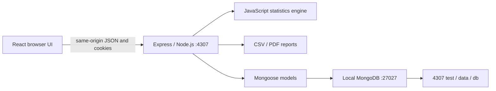
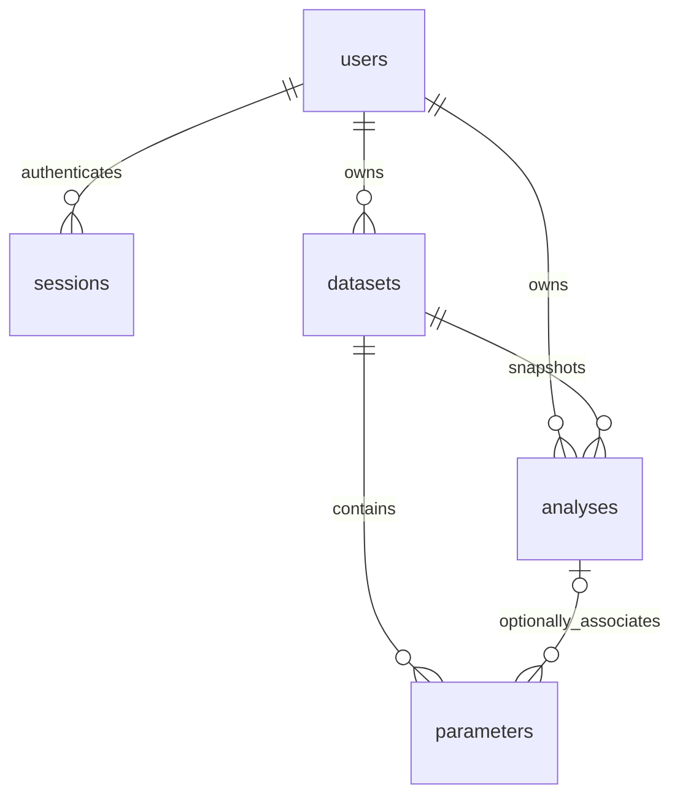

# MERN architecture

The production frontend is built with Vite and served by Express. Development uses Vite on 5307 with an API proxy to Express. Both modes keep API calls on the browser's current origin. Hash routing allows refresh and direct navigation to dataset and analysis screens without web-server route configuration.

## Components

| Component | Responsibility |
| --- | --- |
| `client/src/main.jsx` | React root, account context, navigation, API helper and shared UI |
| `client/src/workspace.jsx` | Dashboard, dataset cards, history, comparison and settings |
| `client/src/editor.jsx` | Manual, spreadsheet, CSV and grouped dataset editing |
| `client/src/analysis.jsx` | Metric selection, results, Plotly charts and custom parameters |
| `server/app.js` | REST routes, session/CSRF middleware, validation and ownership |
| `server/models.js` | Mongoose documents, unique indexes and session expiry |
| `server/statistics.js` | Deterministic JavaScript statistics and dataset validation |
| `server/reports.js` | CSV exports and paginated PDF report generation |
| `scripts/start.mjs` | Starts the isolated database and runs the app |

The copied CSS, logo and Plotly files retain the visual identity of the source project. The application is rendered with React components; it does not wrap or run the original vanilla JavaScript frontend. Calculations run in JavaScript on Node.js; there is no Python/SQLite runtime dependency.

## MongoDB documents

- **users**: display username, unique lowercase username key, unique normalized email, random salt and scrypt password hash.
- **sessions**: unique SHA-256 token hash, user reference and TTL-indexed expiry date. Expiry is checked on every authenticated request even before MongoDB's TTL sweeper deletes a record.
- **datasets**: owner, title/description, validated bounded data document, revision and timestamps.
- **analyses**: owner, dataset reference, revision, immutable observations/title/description snapshot, server-computed calculation/settings and timestamp.
- **parameters**: owner, dataset reference, optional analysis reference, typed numerical/text value, unit, formula, description and timestamps.

MongoDB ObjectId strings replace the original SQLite integer identifiers. Data is explicitly separate from the original account database. Each dataset stores its ordered columns and rows as one bounded document; an atomic revision filter prevents stale updates. Observation edits increment the revision, while name/description edits preserve it. Saved analyses compare their captured revision to the current dataset revision to derive historical status. Saving recomputes results from server data, ignoring any client-supplied calculation.

Dataset-scoped custom parameters appear across that dataset's reports. Analysis-scoped parameters appear in their selected report. Duplicating a dataset copies dataset parameters; duplicating an analysis copies its scoped parameters. Deleting an analysis releases its parameters to dataset scope. Deleting a dataset removes its analyses and parameters. Cascade cleanup uses explicit MongoDB operations, for this single-server local application; it is not a multi-document transaction.

## Local process and file isolation

The launcher finds an existing MongoDB Community Server executable but does not change its installed Windows service. Its separate `mongod` binds to 127.0.0.1:27027 with `--dbpath` pointing to this folder's `data/db`. Logs and startup metadata go to `.runtime`. On shutdown, the launcher stops only child processes it owns; a database it reused is left running.

Express binds to 127.0.0.1:4307. The configuration supports local use. No data is sent to Atlas or another cloud service. The original project, SQLite data and running MongoDB service are not used as storage.

## Security and statistical policy

Authentication uses Node's built-in scrypt, random per-account salts, hashed random session tokens, HttpOnly/SameSite=Strict cookies and 12-hour or 30-day session lifetimes. Mutations require a double-submit CSRF header obtained from `/api/me`; supplied origins are allowlisted for local app ports. Account requests are rate-limited. Request bodies and uploads are bounded. User input is passed through React's text rendering, and private queries always constrain ownership. Helmet supplies response headers and a local-assets content security policy. CSV export neutralizes formula-leading strings.

Quantiles use type-7 interpolation. Sample variance uses n−1 and population variance uses N. Skewness and excess kurtosis use sample bias corrections. Z-scores use population standard deviation. Coefficient of variation uses sample spread over the absolute mean. Paired missing-value handling drops whole pairs; weights are matched to retained source rows. Spearman ranks average ties. Class intervals use midpoint estimates and exact value frequencies expand to observations. Undefined metrics return null with explanations. See `server/conventions.json` and the original metric definitions retained in `server/catalog.json`.

The launcher preserves accounts and work across restarts. Accounts are created only through registration; new workspaces start empty. The application supplies no email reset service, remote deployment setup or sharing model.
